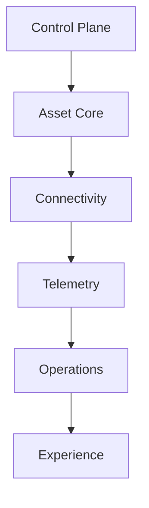

# Matriz de módulos del MVP

| Módulo | MVP | Unidad desplegable | Datos propietarios | Dependencias permitidas |
|---|---:|---|---|---|
| Identity & Access | Sí | Proveedor OIDC + backend | Referencias de identidad | Control Plane |
| Control Plane | Sí, mínimo | Backend modular | tenant, membership, role, entitlement | Identity |
| Asset Core | Sí | Backend modular | site, area, asset, template, variable | Control Plane |
| Connectivity | Sí | Backend + Edge | gateway, mapping, config version | Asset Core |
| Telemetry | Sí | Worker + backend consulta | sample, latest value | Connectivity, Asset Core |
| Operations | Sí | Backend modular | event, alarm, transition | Telemetry, Asset Core |
| Experience | Sí | Web app | Preferencias no críticas | APIs de módulos MVP |
| Reporting | Básico | Backend modular | definición fija/exportación | Telemetry, Operations |
| Maintenance/CMMS | No | Futuro | work order, plan, spare | Asset Core, Operations |
| Documents | No | Futuro | document metadata | Asset Core |
| AI Engineer | No | Futuro | embeddings, evaluations | Datos aprobados |
| Commercial | No | Futuro | subscription, invoice | Control Plane |
| Integrations | Solo notificación esencial | Backend/outbox | delivery attempt | Operations |

## Regla de dependencia

Las dependencias apuntan hacia capacidades estables. Telemetry no modifica Asset
Core; Operations consume telemetría normalizada; Experience no accede a tablas
directamente.

La figura expresa dependencia funcional, no una cadena síncrona obligatoria.

