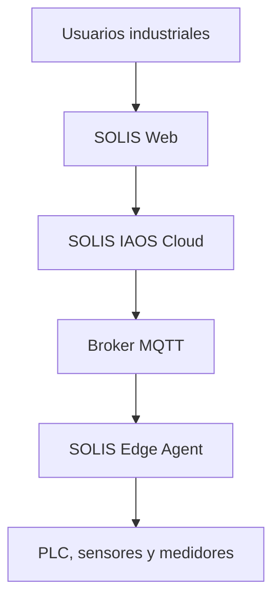
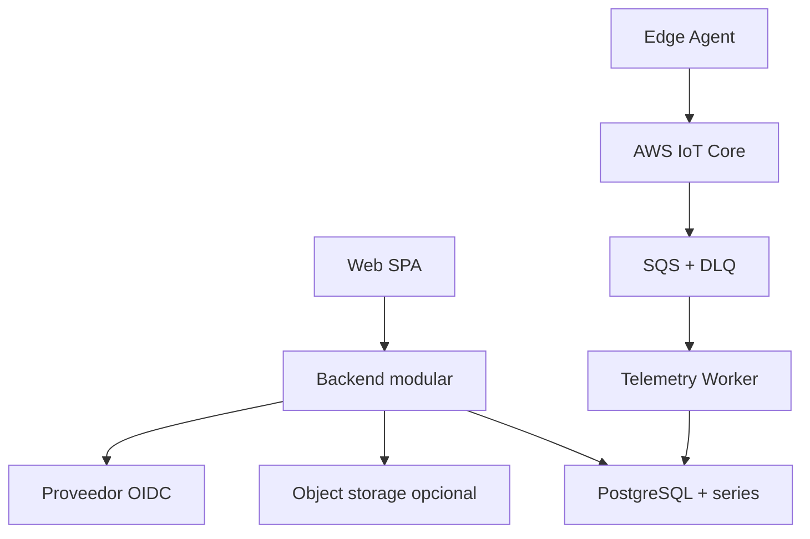

# Arquitectura de sistema V1.2

## Objetivo

Definir la arquitectura objetivo del MVP y sus fronteras de confianza. Esta
vista reemplaza la interpretación de V1.0 basada en once microservicios.

## Contexto

SOLIS IAOS recibe datos desde redes OT sin controlar el proceso. El Edge Agent
inicia conexiones salientes hacia el broker. Usuarios autorizados consultan la
plataforma mediante una aplicación web.

## Contenedores lógicos

## Unidades desplegables del MVP

| Unidad | Responsabilidad | Escala independiente |
|---|---|---:|
| Web | Interfaz industrial | Sí |
| Backend | API, autorización, módulos transaccionales y tiempo real | Sí |
| Telemetry Worker | Consumo MQTT, normalización y persistencia | Sí |
| Edge Agent | Adquisición, buffer y publicación | Por gateway |
| Broker MQTT | Transporte industrial autenticado | Sí |
| Cola de ingesta | Durabilidad y backpressure | Servicio gestionado |
| PostgreSQL | Datos relacionales y series temporales | Vertical/servicio gestionado |
| OIDC | Identidad humana | Servicio externo o autogestionado |

## Límites de confianza

| Zona | Confianza | Controles mínimos |
|---|---|---|
| Red OT | No accesible desde Internet | segmentación, firewall, acceso local |
| Host Edge | Parcialmente confiable | hardening, identidad única, mínimos privilegios |
| Internet | No confiable | TLS, mTLS, rate limit, expiración |
| Broker | Servicio crítico | ACL, límites, logs, no anónimo |
| Cloud application | Confiable por rol | OIDC, RBAC scope, auditoría |
| Data store | Acceso restringido | RLS, cifrado, backup, roles sin BYPASSRLS |

## Flujos principales

### Ingesta

1. El adaptador lee una señal local.
2. Edge normaliza la muestra y asigna identificador/secuencia.
3. La muestra se confirma en el buffer local.
4. Edge publica con QoS 1 usando mTLS.
5. IoT policy valida identidad/topic y una regla entrega a SQS.
6. El worker resuelve identidad confiable y valida contrato/mapeo.
7. El worker persiste de forma idempotente.
8. Se actualiza `latest value`.
9. El backend distribuye un estado agregado al frontend.

### Alarma

1. Operations evalúa una regla aprobada sobre telemetría normalizada.
2. Crea o actualiza una instancia de alarma en una transacción.
3. Registra la transición y auditoría.
4. Publica un evento interno mediante outbox.
5. La interfaz recibe el cambio y muestra estado/severidad.

### Consulta histórica

1. El usuario solicita un intervalo por HTTP.
2. Backend valida tenant, site, recurso y cuota.
3. Telemetry selecciona resolución cruda o agregada.
4. La respuesta se pagina o limita por puntos.

## Restricciones arquitectónicas

- No hay acceso directo del frontend a la base de datos.
- MQTT no es el bus interno general de la aplicación.
- El backend no se conecta directamente a PLC.
- El worker no modifica configuración de activos.
- Ningún módulo accede a tablas de otro módulo sin una interfaz definida.
- Una transacción no se distribuye entre unidades desplegables.
- La extracción de un microservicio requiere ADR y evidencia operativa.
- SQS es backpressure de ingesta; no es un bus de dominio general.

## Evolución

Los módulos futuros se extraerán cuando exista al menos una de estas causas:

- perfil de escala distinto;
- requisito de disponibilidad diferente;
- frontera de seguridad propia;
- ciclo de despliegue independiente comprobado;
- equipo autónomo responsable;
- necesidad contractual de aislamiento.
