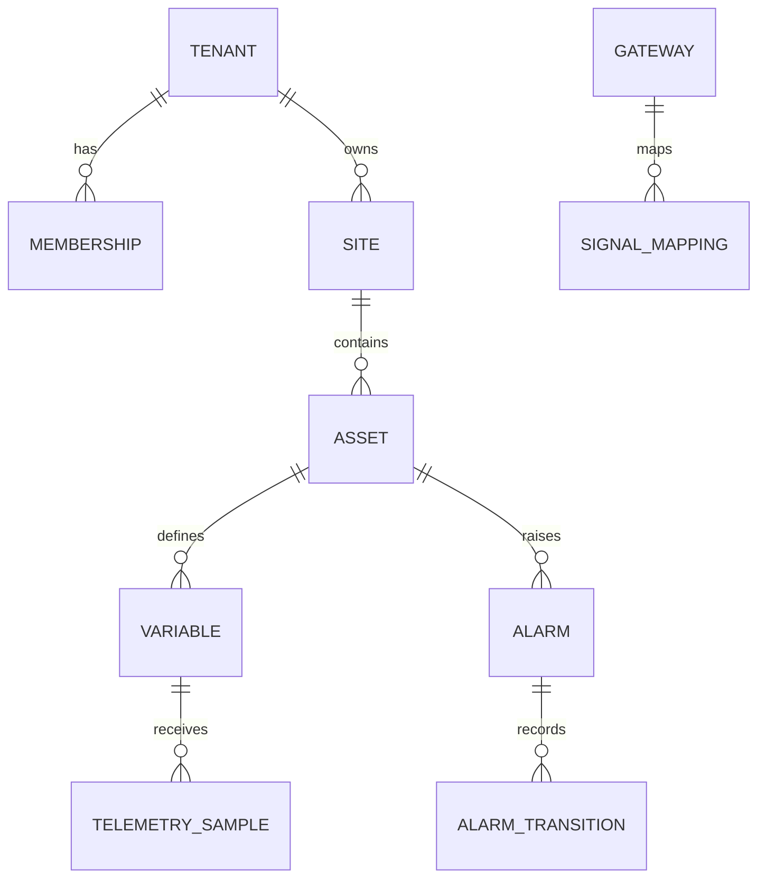

# Arquitectura de datos V1.2

## Principios

1. Datos críticos relacionales.
2. Ownership por módulo.
3. `tenant_id` obligatorio en datos tenant-owned.
4. Restricciones en base además de validación de aplicación.
5. RLS como segunda barrera.
6. Plantillas, configuraciones y contratos versionados.
7. JSONB solo para extensión controlada.
8. Telemetría separada lógica y físicamente de tablas transaccionales cuando el
   motor lo requiera.

## Modelo lógico

El modelo físico y DDL canónicos están en `06_DATA`.

## Ownership

| Esquema lógico | Entidades |
|---|---|
| `control_plane` | tenant, membership, role, scope, entitlement |
| `asset_core` | site, area, asset, type, template, version, relationship, variable |
| `connectivity` | gateway, credential reference, device, signal mapping, config version |
| `telemetry` | sample, latest value, aggregate, ingestion rejection |
| `operations` | rule, event, alarm, transition, acknowledgement |
| `audit` | audit entry, correlation |
| `platform` | outbox, job, migration metadata |

Un módulo no escribe tablas propiedad de otro. Las lecturas cruzadas se realizan
mediante repositorios de consulta o vistas autorizadas.

## Estrategia multi-tenant

- esquema compartido para el MVP;
- `tenant_id NOT NULL`;
- claves únicas incluyen tenant cuando el valor es tenant-scoped;
- claves foráneas compuestas impiden referencias cruzadas;
- RLS `default deny`;
- el rol de aplicación no es propietario de tablas ni posee `BYPASSRLS`;
- trabajos de plataforma usan un rol separado, auditado y limitado;
- pruebas negativas intentan leer, modificar y enlazar datos de otro tenant.

El integrador obtiene memberships explícitas en tenants concretos. No existe
“ver todos los clientes” por ser integrador.

## Activos y plantillas

- El `asset_id` no cambia al renombrar el activo.
- Código industrial y nombre son atributos, no claves primarias.
- Una plantilla publicada es inmutable.
- Un activo referencia una versión concreta.
- Migrar un activo a otra versión es una operación explícita, validada y
  auditada.
- Las relaciones poseen tipo, vigencia y tenant.

## Telemetría

Una muestra conserva al menos:

| Campo conceptual | Propósito |
|---|---|
| tenant, site, gateway | aislamiento y procedencia |
| variable | semántica |
| message id/sequence | idempotencia y orden |
| source timestamp | tiempo en origen |
| ingested timestamp | tiempo de plataforma |
| typed value | valor sin ambigüedad |
| quality | validez declarada |
| mapping/config version | reproducibilidad |

`latest value` se deriva de reglas deterministas. Una muestra tardía se conserva
en histórico, pero no reemplaza automáticamente un valor más reciente.

## Retención

La política se parametriza por clase de dato:

- raw;
- agregado corto;
- agregado largo;
- auditoría;
- configuración;
- rechazos de ingesta.

Piloto: raw 30 días, agregado 1 minuto 13 meses para máximo 200 variables,
agregado 1 hora 36 meses, alarmas/auditoría 36 meses. Toda eliminación es
observable y auditable. ADR-040 gobierna estos valores.

## Backup y restauración

- backups automáticos;
- cifrado;
- retención definida;
- restauración trimestral como mínimo durante piloto;
- separación entre backup de configuración y datos masivos;
- registro del RPO/RTO observado;
- no considerar un backup válido sin prueba de restauración.
