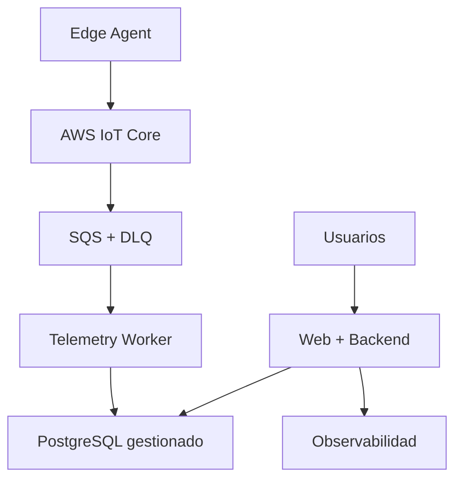

# Arquitectura de despliegue y DevOps V1.2

## Ambientes

| Ambiente | Uso | Datos |
|---|---|---|
| Local | Desarrollo y pruebas rápidas | Sintéticos |
| CI | Pruebas aisladas y efímeras | Sintéticos |
| Staging | Integración y aceptación | Sintéticos representativos |
| Pilot Production | Planta piloto | Reales, protegidos |

No se copian datos reales a desarrollo.

## Topología del piloto

Proveedor: AWS `sa-east-1`. Web estático usa S3/CloudFront/WAF; backend y worker
usan ECS Fargate; RDS PostgreSQL Multi-AZ. La topología completa está en
`08_OPERATIONS/pilot-topology.md`.

## Contenedores

Un artefacto por unidad desplegable:

- web;
- backend;
- telemetry-worker;
- edge-agent/simulator.

Dependencias como PostgreSQL y broker se ejecutan en contenedores solo en local
o cuando el entorno autogestionado lo requiera.

## Sin Kubernetes en MVP

El piloto utiliza una plataforma administrada de contenedores o una VM
endurecida. Kubernetes se reevalúa si aparecen:

- varias réplicas y failover automatizado;
- escalamiento independiente sostenido;
- múltiples equipos;
- políticas de red/orquestación no cubiertas;
- exigencia contractual Enterprise.

## CI

Gates obligatorios:

1. formato y lint;
2. type check;
3. unit tests;
4. integration tests con dependencias reales;
5. pruebas de RLS y aislamiento;
6. validación de migraciones;
7. validación OpenAPI/MQTT;
8. build reproducible;
9. escaneo de dependencias e imágenes;
10. SBOM;
11. pruebas E2E críticas;
12. publicación de artefacto inmutable.

## CD

- ramas cortas sobre `main` protegida;
- pull request;
- despliegue automático a staging;
- smoke test;
- aprobación manual para piloto;
- promoción del mismo digest;
- migraciones compatibles hacia adelante;
- rollback de aplicación;
- restore o forward-fix para datos según runbook.

No se usa una rama `develop` permanente en el MVP.

## Observabilidad

OpenTelemetry instrumenta:

- trazas HTTP y jobs;
- correlación de ingesta;
- métricas;
- logs estructurados.

Métricas mínimas:

- gateways online/offline;
- muestras recibidas/aceptadas/rechazadas;
- lag de ingesta;
- duplicados y fuera de orden;
- uso y antigüedad de buffer Edge;
- latencia API;
- consultas históricas;
- alarmas abiertas y latencia de generación;
- errores por tenant sin exponer datos;
- éxito de backup y restauración.

## Operación

Runbooks:

- despliegue;
- rollback;
- migración;
- rotación de secreto;
- revocación de gateway;
- broker caído;
- worker atrasado;
- base degradada;
- backup/restore;
- incidente de seguridad.

## Infrastructure as Code

Terraform mantiene configuración declarativa, revisada y separada por ambiente.
No se aceptan cambios manuales de producción sin registro.
