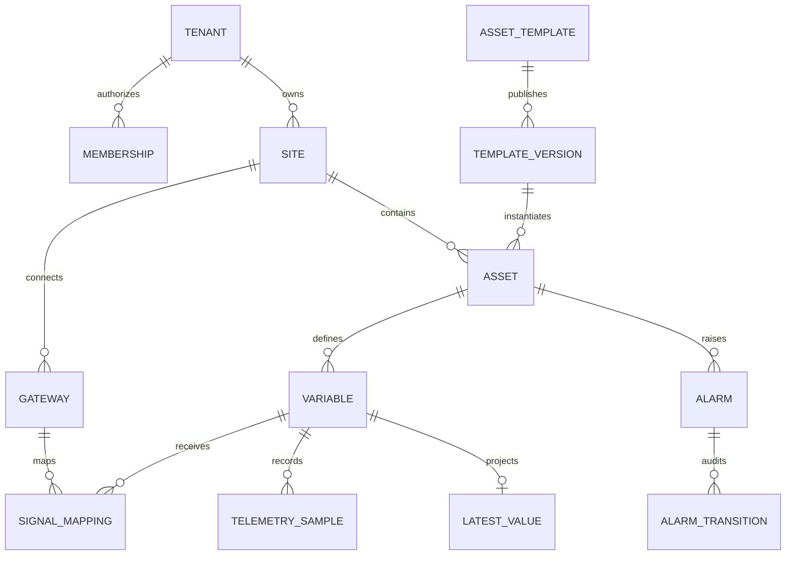
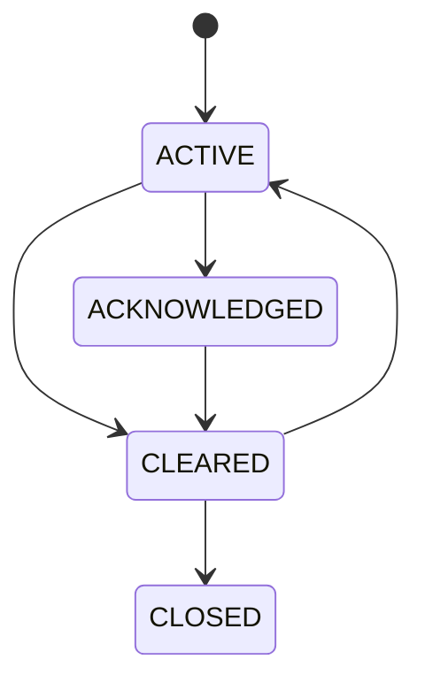

# Modelo físico inicial v1

## Módulos y ownership

| Esquema | Escritura autorizada | Entidades |
|---|---|---|
| `control_plane` | Control Plane | tenant, membership, site scope |
| `asset_core` | Asset Core | site, area, template/version, asset, variable |
| `connectivity` | Connectivity | gateway, credential reference, config, mapping |
| `telemetry` | Telemetry Worker/Query | ingested message, sample, latest, aggregate, rejection |
| `operations` | Operations | rule, alarm, transition |
| `audit` | Audit | audit entry append-only |
| `platform` | Platform | outbox, job, idempotency record |

## Diagrama



## Claves

- UUID v4 en MVP; no contiene significado industrial.
- `code` es clave de negocio mutable bajo control y única dentro del scope.
- todos los padres tenant-owned exponen `UNIQUE (tenant_id, id)`;
- las FK hijas usan `(tenant_id, parent_id)`;
- `asset_id` y `variable_id` permanecen estables al renombrar;
- los identificadores MQTT usan UUID estables, no nombres.

## Tenancy

La aplicación abre una transacción, valida la membership y ejecuta:

```sql
SET LOCAL app.tenant_id = 'uuid-del-tenant';
SET LOCAL app.actor_id = 'subject-oidc';
SET LOCAL app.correlation_id = 'uuid-correlacion';
```

El pool debe limpiar sesión; `SET LOCAL` evita que el tenant sobreviva al
commit/rollback. Una consulta sin contexto recibe cero filas o falla de forma
segura.

El rol de migración es propietario. Los roles `solis_app`, `solis_worker` y
`solis_jobs`:

- no son propietarios;
- no tienen `SUPERUSER`;
- no tienen `BYPASSRLS`;
- no cambian de rol;
- reciben solo permisos sobre las tablas de su módulo.

## Telemetría

### Dedupe

`telemetry.ingested_message` conserva una fila por envelope y una clave primaria
`(tenant_id, gateway_id, message_id)`. La inserción primero reserva la clave. Si
ya existe, el worker contabiliza duplicado y no repite efectos.

### Sample

`telemetry.sample` se particiona por `source_time`. Cada fila conserva:

- identidad y procedencia;
- message/sample index;
- sesión y secuencia;
- versión de configuración/mapping;
- timestamp origen e ingesta;
- un único valor tipado;
- unidad y calidad.

El histórico es inmutable para roles runtime.

### Latest

`telemetry.latest_value` es una proyección con una fila por variable. Se
actualiza únicamente mediante una sentencia condicional que compara timestamp,
secuencia y política de reloj. Un dato tardío puede entrar al histórico sin
reemplazar latest.

### Agregados

Solo variables numéricas marcadas `trend_enabled` generan 1 minuto y 1 hora.
Cada agregado conserva min, max, promedio, primero, último, conteo y distribución
de calidad.

## Alarmas

Una alarma y su transición se escriben en la misma transacción. El estado
permitido es:



El reconocimiento no limpia una condición. El cierre no borra transiciones.

## Auditoría

`audit.audit_entry` es append-only. No almacena tokens, claves privadas, secretos
ni payloads completos. Para cambios críticos registra resumen `before/after`
redactado, actor, tenant, resultado y correlación.

## JSONB permitido

Solo para:

- parámetros no secretos de adaptador, validados por schema;
- snapshot contractual de configuración;
- metadatos de auditoría redactados;
- payload de outbox versionado.

No sustituye entidades, permisos, unidades ni campos usados para joins.

