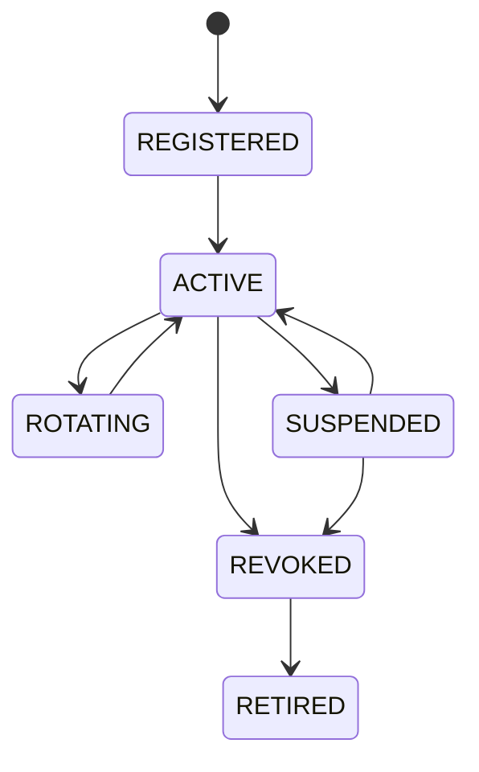

# PKI y ciclo de identidad del gateway

## Objetivo

Cada gateway se autentica con un certificado X.509 único. El certificado se
asocia exclusivamente a una identidad de gateway y a una policy con topics
propios.

## Autoridad

Para el piloto:

- AWS IoT Core administra registro, estado y policies;
- certificados X.509 de dispositivo por gateway;
- CA de AWS para alta asistida inicial;
- claves privadas se generan en el host Edge o en TPM cuando exista;
- la nube conserva referencia y fingerprint, nunca clave privada.

Fleet provisioning masivo se difiere. La instalación inicial es asistida y
requiere operador autorizado.

## Estados

## Emisión

1. Tenant Admin registra gateway y site.
2. Backend crea identidad sin certificado activo.
3. Se genera un token de activación de un solo uso, máximo 15 minutos.
4. Edge genera keypair local.
5. Canal autenticado solicita certificado y demuestra el token.
6. La plataforma asocia certificado exclusivamente al gateway.
7. Se adjunta policy parametrizada por tenant/gateway.
8. Edge prueba conexión y topic propio.
9. Connectivity marca `ACTIVE` y audita.

El token nunca se registra en claro.

## Almacenamiento Edge

Orden preferido:

1. TPM/HSM;
2. keyring del sistema con permisos mínimos;
3. archivo cifrado y legible solo por la cuenta del servicio.

Queda prohibido:

- incluir clave en imagen/container;
- copiarla a logs/backup general;
- compartir certificado entre gateways;
- entregar la clave por correo/chat;
- montar directorio de secretos como escritura global.

## Rotación

- validez objetivo: 12 meses;
- iniciar renovación 30 días antes;
- superposición máxima de dos certificados durante 24 h;
- activar nuevo, probar, retirar antiguo;
- alerta a 30, 14, 7 y 1 día;
- rotación inmediata por sospecha.

## Revocación

La revocación:

1. cambia gateway a `REVOKED`;
2. inactiva certificado;
3. separa policy;
4. cierra conexión activa cuando el proveedor lo permita;
5. invalida configuración pendiente;
6. alerta y crea audit entry;
7. exige nueva identidad para recuperar.

La UI no ofrece “reactivar” un certificado comprometido.

## Recuperación

Ante pérdida de host o credencial:

- revocar primero;
- verificar identidad del técnico y ticket;
- reinstalar desde imagen aprobada;
- generar keypair nuevo;
- realizar alta nueva;
- verificar que no exista acceso al PLC desde Internet;
- ejecutar prueba de publish/ACL y buffer;
- documentar causa y activos afectados.

## Pruebas del gate

- certificado A no publica como B;
- mismo certificado no se asocia a dos gateways;
- certificado expirado/revocado falla;
- rotación sin pérdida mayor al buffer;
- reloj Edge incorrecto no invalida control de identidad;
- clave privada no aparece en base, logs, imagen ni bundle de diagnóstico;
- revocación surte efecto dentro de 5 minutos.

