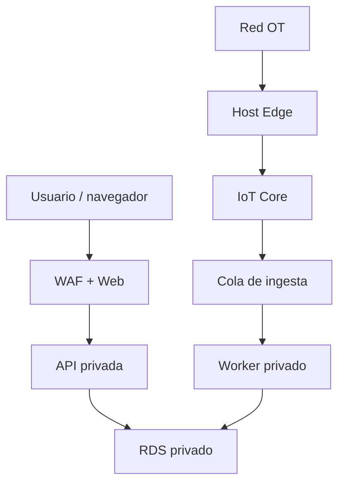

# Threat model IT/OT del MVP

| Campo | Valor |
|---|---|
| Método | STRIDE por flujo y límite de confianza |
| Alcance | Web, API, worker, IoT broker, Edge, PostgreSQL, OIDC, CI/CD |
| Fuera de alcance | seguridad interna del PLC/SIS salvo interfaz Edge |
| Fecha | 26 de julio de 2026 |
| Estado | Diseño cerrado; validaciones del piloto pendientes |

## Activos a proteger

1. aislamiento de cada tenant;
2. integridad del inventario, configuración, alarmas y auditoría;
3. identidad y clave privada de gateway;
4. telemetría industrial y contexto operacional;
5. disponibilidad de ingesta y consulta;
6. red OT y PLC sin exposición;
7. pipeline y artefactos de despliegue.

## Límites

No existe flujo cloud → PLC.

## Registro de amenazas

| ID | STRIDE | Escenario | Impacto | Control preventivo/detectivo | Validación | Dueño | Residual |
|---|---|---|---|---|---|---|---|
| T-01 | S | token humano robado | acceso tenant | OIDC, expiración, TOTP admin, sesión segura | token/session tests | Security | Medio |
| T-02 | E | rol gana permisos indebidos | administración | matriz deny-default, revisión de grants | authorization suite | Backend | Bajo |
| T-03 | I | consulta cross-tenant | fuga industrial | scope app, FK tenant-aware, RLS forzada | RLS-001–024 | Data | Bajo |
| T-04 | S | gateway falsificado | datos falsos | mTLS, cert exclusivo, client ID exacto | ACL/PKI tests | Connectivity | Bajo |
| T-05 | T | payload declara otro gateway | contaminación | identidad/topic autoritativos, reject | identity mismatch test | Telemetry | Bajo |
| T-06 | R | usuario niega acknowledgement | pérdida trazabilidad | audit append-only, actor/correlación | transition test | Operations | Bajo |
| T-07 | D | tormenta MQTT | ingesta caída/costo | cuotas, payload cap, queue, alarmas | load/reconnect test | Platform | Medio |
| T-08 | D | reconnect storm | saturación broker/worker | backoff+jitter, queue, autoscaling limitado | 50 gateways simulados | Edge/Platform | Medio |
| T-09 | T | duplicado/replay | doble efecto/alarma | message ID, sequence, dedupe | duplicate suite | Telemetry | Bajo |
| T-10 | T | dato fuera de orden | latest incorrecto | precedencia determinista | out-of-order suite | Telemetry | Bajo |
| T-11 | T | config Edge maliciosa | pérdida de adquisición | schema, firma/contexto, apply atómico, rollback | invalid config tests | Connectivity | Medio |
| T-12 | E | config se usa como comando | impacto OT | allowlist de adapters/mappings, no command fields | contract forbidden scan | Architecture | Bajo |
| T-13 | I | secreto en log | compromiso | redacción, scanner, secret manager | log/secret scan | Platform | Bajo |
| T-14 | T | dependencia comprometida | ejecución arbitraria | lockfile, SBOM, scan, firma, digest | CI supply-chain gate | DevOps | Medio |
| T-15 | T | migración rompe RLS | fuga/caída | test catálogo, review, forward-compatible | migration/RLS test | Data | Bajo |
| T-16 | D | RDS no disponible | plataforma degradada | Multi-AZ piloto, PITR, buffer Edge | failover/restore drill | Platform | Medio |
| T-17 | D | disco Edge lleno | pérdida de datos | límite tiempo/tamaño, alerta, política explícita | buffer-full test | Edge | Medio |
| T-18 | I | diagnóstico contiene payload/PII | fuga | campos allowlist, sin dump, expiración | bundle inspection | Edge/Security | Bajo |
| T-19 | R | admin soporte accede sin caso | abuso interno | elevación temporal, MFA, ticket, audit | access review | Security | Medio |
| T-20 | S | DNS/TLS spoofing | desvío Edge/web | TLS verificado, hostname pin policy, HSTS | TLS tests | Platform | Bajo |
| T-21 | D | export masivo | costo/DoS | límites, jobs, cuotas, expiración | export quota test | Reporting | Bajo |
| T-22 | I | URL de reporte compartida | fuga | URL firmada corta, tenant/job check | URL expiry test | Reporting | Bajo |
| T-23 | T | reloj gateway incorrecto | secuencia falsa | clock status, ingested time, alarmas | clock test | Edge/Telemetry | Medio |
| T-24 | D | pérdida de cola | mensajes no procesados | cola gestionada, DLQ, métricas, redrive | DLQ drill | Platform | Bajo |
| T-25 | E | contenedor comprometido llega a OT | pivot a PLC | Edge least privilege, firewall egress, sin acceso cloud entrante | host hardening review | OT/Edge | Medio |

## Riesgos no aceptables

- cualquier capacidad de control remoto no diseñada;
- wildcard MQTT que abarque varios tenants;
- rol runtime con `BYPASSRLS`;
- gateway compartiendo certificado;
- API/DB/worker accesibles directamente desde Internet;
- backup no restaurado;
- secreto versionado;
- vulnerabilidad crítica explotable sin excepción y mitigación.

## Privacidad y datos

Los nombres de personas solo se almacenan en el proveedor OIDC o en la mínima
auditoría necesaria. Topics no contienen nombres de cliente/planta/activo. Logs
de error no contienen valor completo de telemetría salvo modo diagnóstico
temporal aprobado.

## Validaciones previas al piloto

- tabletop T-03, T-04, T-07, T-16, T-17 y T-25;
- test automático del resto;
- revisión de firewall/zonas OT por responsable de planta;
- pentest acotado de autenticación, tenancy y API;
- cierre o aceptación formal de riesgos residuales medios.

