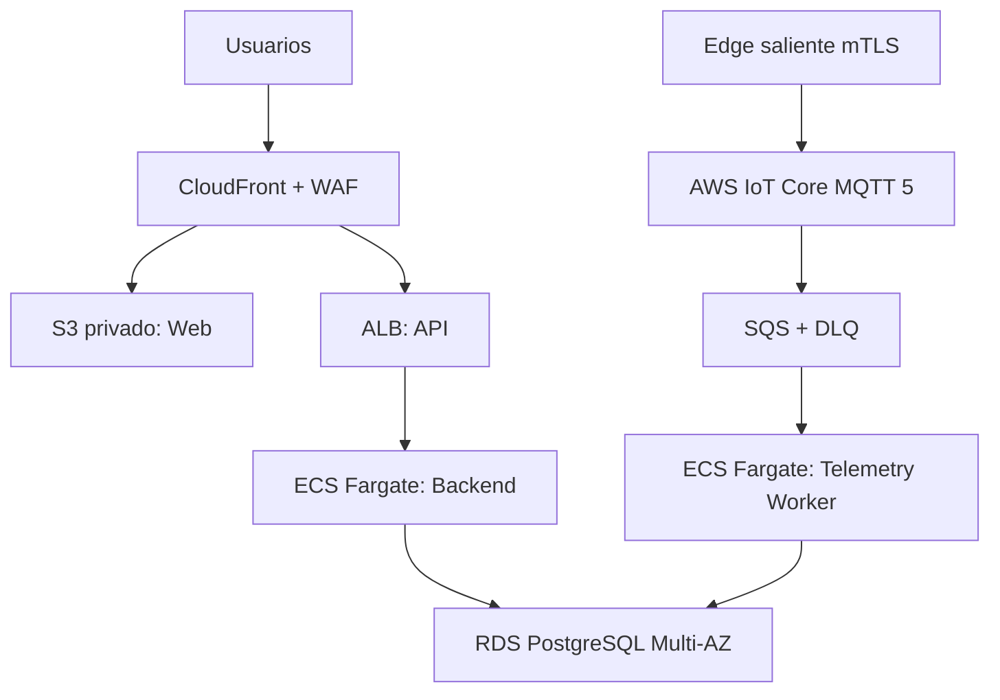

# Topología de despliegue del piloto

## Landing zone

| Cuenta | Propósito |
|---|---|
| `solis-security-backup` | logs, evidencias y copias cross-account |
| `solis-nonprod` | CI, staging y pruebas sintéticas |
| `solis-prod` | Pilot Production |

No se comparten bases, certificados ni secretos entre cuentas.

## Región

- primaria: `sa-east-1` (São Paulo);
- dos Availability Zones para subredes privadas y RDS Multi-AZ;
- sin multi-región en MVP;
- residencia contractual debe aprobarse antes de datos reales;
- una futura región más cercana requiere análisis de servicios, costo, latencia y
  migración, no cambio automático.

## Vista

## Red

- VPC por ambiente.
- ALB público solo como origen protegido por WAF/CloudFront.
- ECS y RDS sin IP pública.
- subredes privadas en dos AZ;
- security groups por flujo, no por rango amplio;
- RDS acepta únicamente backend, worker y jobs autorizados;
- VPC endpoints para servicios cuando reduzcan exposición/costo;
- salida NAT allowlisted/monitorizada para tareas que la requieran;
- no existe VPN o ruta cloud→OT en MVP.

El Edge inicia conexión TLS por Internet hacia IoT Core. Ningún puerto de PLC,
Modbus o host Edge se publica.

## Servicios

| Capacidad | Servicio piloto | Portabilidad |
|---|---|---|
| Web | S3 privado + CloudFront | build estático |
| API | ECS Fargate + ALB | imagen OCI |
| Worker | ECS Fargate | imagen OCI |
| Identidad | Cognito User Pool | OIDC |
| MQTT/PKI | AWS IoT Core | contrato MQTT 5/X.509 |
| Backpressure | SQS Standard + DLQ | puerto de cola |
| Datos | RDS PostgreSQL 17 | SQL PostgreSQL |
| Objetos/reportes | S3 | puerto de object storage |
| Secretos | Secrets Manager | interfaz de secretos |
| Observabilidad | CloudWatch + OpenTelemetry | OTLP |
| IaC | Terraform | módulos por proveedor |

PostgreSQL 17 es la línea objetivo inicial; Sprint 0 fija minor soportado y
prueba upgrade. No se adopta una extensión que obligue a autogestionar la base.

## Flujo de ingesta

1. Edge publica MQTT 5 con QoS 1 y certificado.
2. IoT policy verifica client/topic.
3. IoT Rule agrega metadatos confiables de conexión y envía a SQS Standard.
4. SQS entrega at-least-once al worker.
5. Worker resuelve gateway/tenant desde metadatos confiables.
6. Valida JSON Schema, config, mapping, tipo y unidad.
7. Reserva dedupe y persiste por lote.
8. Fallas recuperables vuelven a cola; poison messages llegan a DLQ.

SQS puede reordenar o duplicar; el contrato ya exige idempotencia y manejo de
fuera de orden.

## Flujo de configuración

Backend autorizado publica `config/desired` mediante IoT Data Plane. No se
almacena una credencial MQTT general dentro del backend. La configuración:

- está versionada;
- no contiene secretos;
- se aplica atómicamente;
- reporta resultado;
- no contiene comandos ni setpoints.

## Naming y tags

Formato: `solis-{env}-{region}-{service}-{purpose}`.

Tags obligatorios:

- `system=solis-iaos`;
- `environment`;
- `owner`;
- `cost-center`;
- `data-classification`;
- `criticality`;
- `managed-by=terraform`;
- `backup-class`;
- `retention-class`.

Se corrige cualquier plantilla heredada que use `system=ingeniero-ia`, porque
mezclaría costos y ownership de proyectos distintos.

## Despliegue

- artefactos OCI inmutables;
- digest promovido staging→pilot;
- tareas Fargate sin shell/SSH;
- ejecución non-root cuando la imagen lo permita;
- secretos inyectados en runtime;
- migración como tarea separada y aprobada;
- rollback de aplicación; datos por forward-fix o restore según runbook;
- producción no admite cambios manuales sin registro.

## Kubernetes

No forma parte del piloto. Se reevalúa solo con evidencia de varias réplicas,
equipos autónomos, políticas no cubiertas o requisitos Enterprise.

