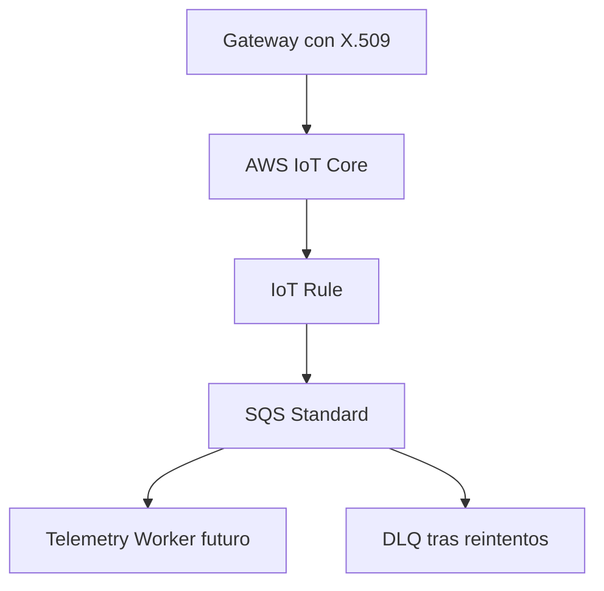

# Arquitectura AWS IoT preparada por V0.5

## Fronteras

| Componente | V0.5 | Activación posterior |
|---|---|---|
| Gateway/Thing | Identidad sintética | Registro físico y FAT |
| Certificado | Excluido | Emisión externa, rotación y revocación |
| IoT policy | Definida sin attachment | Revisión y asociación al certificado |
| IoT Rule | Definida y deshabilitada | Habilitación por plan aprobado |
| SQS/DLQ | Definidas | Creación en cuenta nonprod |
| Worker | No se despliega | Consumo por lotes e idempotencia |

## Topics permitidos al gateway

- `solis/v1/tenants/{tenantId}/gateways/{gatewayId}/telemetry`
- `solis/v1/tenants/{tenantId}/gateways/{gatewayId}/status`
- `solis/v1/tenants/{tenantId}/gateways/{gatewayId}/diagnostics`

La policy no permite `Subscribe`, `Receive`, comandos ni publicación en topics
de otro tenant o gateway.
